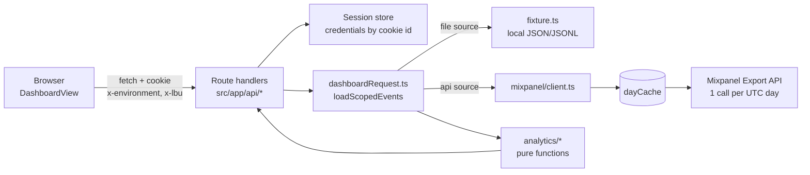

# Architecture

How the Pruservices Customer Journey Dashboard is put together. Requirements are in [PRD.md](PRD.md), task status in [progress.md](progress.md).

## Overview

A Next.js (App Router) app with a thin React client and a server side that talks to Mixpanel. The browser never sees Mixpanel credentials: the user signs in once, the server keeps the credentials in memory, and every dashboard request is made on their behalf.

## Layers

| Layer | Where | Responsibility |
|-------|-------|----------------|
| Pages | `src/app/page.tsx`, `src/app/login/page.tsx` | Server components. `/` redirects to `/login` when there is no session. |
| UI | `src/components/` | Client components. `DashboardView` owns all state and fetching; the rest are presentational. |
| Route handlers | `src/app/api/*/route.ts` | Check the session, validate the query, load data, build the response, map errors. |
| Request helpers | `src/lib/dashboardRequest.ts` | Shared by the routes: `loadScopedEvents`, `errorResponse`. |
| Mixpanel access | `src/lib/mixpanel/` | HTTP client, caches, local-file source, shared types. Server only (`server-only`). |
| Analytics | `src/lib/analytics/` | Pure functions from events to what the UI shows. No I/O. |
| Validation | `src/lib/validation.ts` | Query, header and login-body parsing. |
| Session | `src/lib/session/` | In-memory credential store and cookie lookup. |

## Sign-in and sessions

1. `LoginForm` posts the service account user, secret, project ID and region to `POST /api/login`.
2. The route validates the body, then calls `verifyCredentials`, which makes one `limit=1` Export call for today. A 401/403 from Mixpanel becomes a 401 "rejected these credentials".
3. On success `createSession` stores the config in a server-side `Map` under a random UUID and the route sets the `mp_session` cookie: `httpOnly`, `sameSite=strict`, `secure` in production, 8-hour max age.
4. Every data route calls `getCurrentConfig()`, which reads the cookie and looks up the config. Each use extends the idle expiry by 8 hours. No session means a 401, and the client redirects to `/login`.
5. `POST /api/logout` destroys the session and clears the cookie.

The store lives on `globalThis` so route handlers, server components and dev hot reloads share one map.

## Request flow

Every data view works the same way:

1. `DashboardView` keeps **pending** filter edits separate from **applied** filters. Only Apply, paging, switching pages, and Refresh trigger a fetch.
2. The fetch sends Environment and LBU as `x-environment` and `x-lbu` headers. Window, date, paging and `refresh` go in the query string.
3. The route calls `validateDashboardQuery`, which returns a typed query or a 400.
4. `loadScopedEvents` turns the query into a date range and gets events (see Data sources). Events are filtered again locally by Environment and LBU so the file and API paths are scoped identically.
5. A pure `build*` function from `src/lib/analytics/` shapes the response. The route adds `fetchedAt`.
6. Failures go through `errorResponse`, which logs the real cause server-side and returns a short, safe message.

### API routes

| Route | Returns | Mixpanel cost |
|-------|---------|---------------|
| `POST /api/login`, `POST /api/logout` | 204 | 1 Export call at login |
| `GET /api/dashboard` | Events page: most/least visited, time on page, raw events | 1 Export call per UTC day in the window |
| `GET /api/users` | Users page, most recent first | Same |
| `GET /api/users/events?userId=` | One user's events and most/least visited pages | Same |

Query parameters: `window=1h|24h|day`, `date=YYYY-MM-DD` (required for `day`), `capability`, `eventType`, `page`, `pageSize` (10, 25 or 50), `refresh=1`. `eventType` is trimmed, at most 100 characters, and matches events whose name contains it, ignoring case. It applies to `/api/dashboard` and `/api/users/events`; `/api/users` ignores it.

## Data sources

`resolveDataSource()` picks one of two sources:

- **`api`** (default): the Mixpanel client below.
- **`file`**: local JSON or JSONL exports named in `MIXPANEL_EVENTS_FILE`, for development without credentials. Selected by `MIXPANEL_DATA_SOURCE=file`, or automatically when `MIXPANEL_EVENTS_FILE` is set and the flag is not.

### Export API: one call per UTC day

`fetchEventsWithMeta` expands the range into days and fetches each with `GET /api/2.0/export` for all events. Environment and LBU go into a server-side `where` clause so Mixpanel returns less data. Up to 3 days run at once (Mixpanel's 3 queries/second limit), each with a 60-second budget. Results are concatenated in day order. If any day fails, the whole request fails; there is no partial result.

### Day cache

`dayCache.ts` keeps each fetched day in memory:

- Key: region, project, sorted filters and the day. Credentials are deliberately not part of the key.
- Lifetime: 12 hours for a finished UTC day, 60 seconds for today.
- Bounded to 120 entries, oldest evicted first.
- Stores the promise, so concurrent requests share one call. Failures are not cached.
- Each entry records `fetchedAt`. A response reports the **oldest** `fetchedAt` of the days it used, which the UI shows as "Data as of".
- `refresh=1` forces a reload of every day in the request. If the reload fails, the previous entry is put back.

### Mixpanel's hourly limit

Mixpanel allows 60 Export queries per hour, and a cold 30-day export costs about 31. This is why "Last 30 days" is not a window option: the time ranges are Last hour, Last 24 hours and a single day, which cost at most 2 calls each.

## Analytics

Pure functions in `src/lib/analytics/`; nothing here touches the network.

- `sessions.ts`: `toPageViews` keeps `page_viewed` events that have a user, page and time. `buildSessions` splits a user's views into sessions with a 30-minute inactivity gap, since Mixpanel has no session ID.
- `timeOnPage.ts`: time on a page is the gap to the user's next view in the same session. A session's last view has no duration.
- `pageVisits.ts`: views and unique visitors per page.
- `dashboard.ts`, `users.ts`: assemble each route's response, including server-side pagination of the events and users tables.

## Client

`DashboardView` is the only stateful component. It holds pending and applied filters, the active left-pane item, the selected user, the load status and the `fetchedAt` time, and runs one effect that fetches the active item. Changing a filter never fetches by itself. A Refresh click sets a one-shot flag so only that request carries `refresh=1`.

`FilterBar` edits pending values. `DataFreshness` shows "Data as of" and the Refresh button. `PaginatedTable` pages in the browser; `EventsTable` and `UsersTable` page on the server.

`EventsTable` also owns the event type filter. The text being typed is local state; it is promoted to `applied.eventType` in `DashboardView` on Enter or the filter's own Apply button, which resets to page 1 and refetches. `applied.eventType` is cleared when the nav item, selected user or users list changes. The User cell is a button when `onSelectUser` is passed: on the Events page it switches to Users and selects that user (`openUserFromEvents`). Rows with `event === "error_encountered"` get the `event-error` class (light red).

## Error handling

`MixpanelError` has a `kind`, which `errorResponse` maps to an HTTP status and a fixed public message. Upstream detail is logged on the server and never returned.

| Kind | Status |
|------|--------|
| `config` | 500 |
| `auth` | 502 |
| `rate_limit` | 429 |
| `no_access` | 502 |
| `timeout` | 504 |
| `upstream` | 502 |

Validation failures are 400, a missing session is 401. Route handlers declare `maxDuration = 300`.

## Security notes

- Credentials exist only in server memory and the login request body; they are never returned, logged or stored in the browser.
- The session cookie is `httpOnly` and `sameSite=strict`.
- Environment and LBU values go into a Mixpanel expression, so they are checked (Environment against a fixed list, LBU against a character pattern with quotes and control characters rejected) and escaped by `propertyWhereClause`.

## Limits and known gaps

- **Single-process memory.** Sessions and both caches live in the Node process. They reset on restart (users are sent back to `/login`) and are not shared between instances, so this suits one long-running server, not serverless or multiple replicas.
- **Shared cache.** Cache keys exclude credentials, so everyone signed in to the same project shares cached days, and one person's Refresh updates it for all.
- **No call budget.** Nothing counts calls against the 60/hour limits; a 429 from Mixpanel is just reported.
- **Timezone.** Mixpanel reads `from_date`/`to_date` in the project's timezone while the app uses UTC days, so day edges can differ if the project is not on UTC.
- **Temporary code.** `logScopeDiagnostics` in `dashboardRequest.ts` is marked for removal.
- **Out-of-date docs.** PRD.md still describes credentials in environment variables, fixed LBU values and dashboard authentication as out of scope. The app now takes credentials at login, accepts any LBU value, and has a login. The `MIXPANEL_SERVICE_ACCOUNT_*`, `MIXPANEL_PROJECT_ID`, `MIXPANEL_API_SECRET` and `MIXPANEL_REGION` entries in `.env.example` are no longer read by the routes; `MIXPANEL_DATA_SOURCE` and `MIXPANEL_EVENTS_FILE` still are.

## Testing

Jest with Testing Library; each module has a `.test.ts(x)` next to it. Server modules use the node environment and inject `fetch`, so no test calls Mixpanel. Run `npm test`, `npm run lint` and `npx tsc --noEmit`.
